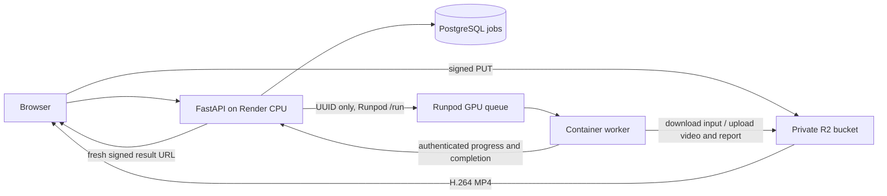

# Local and cloud video deployment

Implementation is on `deployment/cloud-inference`; **not deployed**. Selected models are unchanged and `src/temporal/` is untouched. The original combined-demo command remains supported. The website accepts uploaded files independently of `data/videos` and isolates every job.

## Architecture



Locally, the same API uses SQLite, files and a separate sequential worker. Cloud video bytes go directly to R2. The GPU worker never connects to the database. Each inference uses a separate subprocess, fresh tracker and temporal pipeline, UUID directory and execution timeout. No pose/calibration caches are shared between jobs. Conditional database updates prevent duplicate starts and claims.

Optimizations implemented: skip intermediate pose/shuttle preview encoding, stream pose records to JSONL, pass the selected device to player detection, use Torch inference mode, and encode the final MP4 as H.264/yuv420p with faststart. Models now consume untouched frames before preview drawing. Previously, boxes drawn for one player could contaminate the next player's model input. Compare a new video before release: this is a correctness fix, not a promise of bit-identical old predictions.

Trained keypoints, near/far slots, temporal feature construction, shuttle normalization, thresholds, precision and frame sampling remain unchanged. Models reload per video for isolation. Warm model caching, FP16, TensorRT/ONNX, frame skipping and concurrent inference need accuracy/memory benchmarks first. MediaPipe and FFmpeg still use CPU. Each `report.json` records stage times, selected weight checksums, input metadata and warnings. Transfer, queue and cold-start latency are additional. No measured speedup is claimed yet.

## Asset readiness and remaining setup

1. **`yolo11n.pt` exists locally but is not tracked.** Put this selected file into the cloud image build workspace. Use the local copy or a trusted versioned model artifact, rather than relying on a first-job download. Its expected checksum is in `configs/deployment_models.json`.
2. **Docker Desktop's Linux engine was unavailable during setup.** Start Docker Desktop and complete the image build/GPU smoke tests below. Container builds and GPU performance remain unverified.
3. **No raw videos are present under `data/videos` here.** Supply an unseen raw MP4 for full local/cloud acceptance testing. Existing overlay videos are unsuitable as accuracy tests.

The complete model manifest is already recorded. Verify it before building:

```powershell
.\.venv\Scripts\python.exe -m src.deployment.preflight
```

Use `--record` only when deliberately selecting/restoring models, never to bypass an unexpected checksum mismatch. Commit the reviewed manifest with the selected checkpoint. This does not download or retrain anything.

## Run locally

From the repository root in Windows PowerShell, keep the existing ML environment and add web dependencies:

```powershell
.\.venv\Scripts\python.exe -m pip install -r requirements-api.txt
.\.venv\Scripts\python.exe -m src.deployment.preflight
.\.venv\Scripts\python.exe -m uvicorn src.deployment.api:create_app --factory --host 127.0.0.1 --port 8000 --no-access-log
```

In a second terminal from the same repository:

```powershell
.\.venv\Scripts\python.exe -m src.deployment.worker
```

Open http://127.0.0.1:8000 and upload a raw MP4. Default state is `outputs/deployment/jobs.sqlite3`; artifacts are in `outputs/deployment/jobs/<UUID>/`. Both processes must use the same environment and `JOB_ROOT` / `DATABASE_URL`. See `deployment/local.env.example`. Set PowerShell variables with `$env:NAME = 'value'`. The application does not implicitly load env files. Uvicorn supports `--env-file`, but the worker must receive the same settings separately.

File-only invocation, without API (workspace must be fresh):

```powershell
.\.venv\Scripts\python.exe -m src.deployment.pipeline C:\clips\rally.mp4 outputs\manual-run-01\work outputs\manual-run-01\result.mp4 --device auto
```

FFmpeg and ffprobe must be on PATH. Default limits: 200 MiB, 60 seconds, **1280x720**, 1–60 fps, no rotation metadata. The resolution guard preserves the existing model's original-pixel feature assumptions. No automatic resizing, frame dropping or enhancement occurs. The phase model trained around 30 fps: use approximately 30 fps clips for acceptance tests; other accepted frame rates are not validated for phase quality. Output is silent. Other resolutions, long matches and camera cuts need an explicit preprocessing/segmentation policy before wider use.

If the local worker is interrupted, stop all old workers, then run `python -m src.deployment.worker --recover`. This marks interrupted jobs failed rather than reusing incomplete artifacts. Queued jobs survive API restarts. Submit failed inputs as new jobs after resolving their `worker.log`. Run only one worker on a small local GPU.

## Manual cloud setup

Use staging resources first. No credentials, paid resources or deployments were created by this change.

1. **R2:** create a private bucket. Configure scoped object read/write credentials and replace the origin in `deployment/r2-cors.json` with the actual HTTPS website origin. Uploads sign Content-Type `video/mp4`. Configure lifecycle deletion of the entire `jobs/` prefix, for example after seven days, and tell users the retention period. This covers temporary uploads, frozen inputs and results. Keep bucket credentials server-side.
2. **GPU image:** restore the shuttle checkpoint, include the selected base YOLO file, review the manifest, and start Docker. Build Linux AMD64:

   ```powershell
   docker build --platform linux/amd64 -f deployment/Dockerfile.worker -t YOUR_REGISTRY/rallymirror-worker:VERSION .
   docker run --rm --gpus all --entrypoint python YOUR_REGISTRY/rallymirror-worker:VERSION -c "import torch; print(torch.__version__); assert torch.cuda.is_available()"
   docker run --rm --entrypoint python YOUR_REGISTRY/rallymirror-worker:VERSION -m src.deployment.preflight
   ```

   The candidate Linux runtime uses Python 3.13, Torch 2.11.0 / torchvision 0.26.0 from the available CUDA 12.8 wheel index. Local model-loading checks used Windows Torch 2.14.1; this is **not cross-platform parity evidence**. Build arguments allow selecting another matched Torch pair/index for your GPU. A cross-platform wheel-resolution dry run succeeded for the candidate runtime; this does not execute native libraries or verify CUDA. The real Linux build and GPU video run must pass before promotion. Worker dependencies belong in the separate Linux image; do not indiscriminately replace the working Windows ML environment. Once staging passes, freeze transitive dependencies from that image and deploy its immutable registry digest.
3. **Registry:** log in and push the tested versioned worker image. Provide private registry credentials to Runpod if needed. Image publishing is a manual step.
4. **Runpod:** create a queue-based Serverless endpoint with that image digest. Start with a roughly 24 GB NVIDIA GPU, minimum active workers zero, maximum workers one, and one job per worker. Inspect actual memory and timings. Allow a 1800-second endpoint execution timeout; submissions explicitly set a 1800-second execution policy and two-hour total TTL. Tighten limits after benchmarking.
5. **Render:** review `render.yaml`, which proposes paid starter web hosting and basic PostgreSQL in Singapore. Connect the repository/branch and apply the Blueprint after reviewing the plans. The API image has no ML dependencies or model files. Fill every `sync: false` variable; set `API_BASE_URL` to the deployed HTTPS origin. Database URLs are normalized to psycopg. `/healthz` checks database access.
6. **Secrets:** `deployment/cloud.env.example` lists API variables and the smaller worker subset. Use different random values for the team website key (`APP_ACCESS_TOKEN`) and callback secret (`WORKER_SECRET`). For example, generate each with `python -c "import secrets; print(secrets.token_urlsafe(32))"`. Set worker `INFERENCE_DEVICE=cuda`; it must fail if CUDA is unavailable. API and worker share callback secret, HTTPS API origin, bucket credentials and limits. Do not give workers the database password or Runpod submission API key. Never commit actual tokens/env files.
7. **Networking:** browser uploads/downloads must reach R2; workers must reach Render HTTPS and R2. No worker access to the private database is required. Website and API share an origin, so API CORS is unnecessary. Result access uses fresh signed URLs.

Provider references: [Runpod queue requests and execution policies](https://docs.runpod.io/serverless/endpoints/send-requests), [Runpod handlers](https://docs.runpod.io/serverless/workers/handler-functions), [R2 presigned URLs](https://developers.cloudflare.com/r2/api/s3/presigned-urls/), [Render Blueprints](https://render.com/docs/blueprint-spec).

## Acceptance before calling this deployed

- Run the same unseen, approximately 30 fps clip locally and in the GPU image. Compare frame count, resolution, near/far identities, 18 named keypoints, phase labels, court and shuttle overlays. Inspect warnings. Rejected court calibration is visibly flagged and can reduce phase quality.
- Test upload, queue, progress, playback, download and report from a teammate's browser. Repeat with a distinct video to check isolation. Signed URLs renew on reload.
- Test invalid resolution, empty/oversized input, wrong job token, absent checkpoint, bad credentials and GPU timeout. Failed inference must not be shown as successful.
- Restart the API during a job. PostgreSQL should retain state; callbacks/provider-status reconciliation should recover completion. Duplicate start/claim must not rerun inference.
- Benchmark short and maximum-length clips: transfer, queue/cold start, stage times, total wall time, peak GPU memory, CPU/RAM and actual cost. Do not claim real-time performance or local/cloud accuracy parity without evidence.
- Verify lifecycle deletion, spending alerts and the worker cap. Database rows and local artifacts also need retention maintenance; that maintenance is manual in this version.

## API and operations

`POST /api/jobs` uses the team key, if configured, and returns a UUID, private per-job token and upload URL. The browser retains its current job capability locally. PUT using the returned headers, then POST `/api/jobs/<id>/start`. Use the job Bearer token for GET `/api/jobs/<id>` and `/result?artifact=video|report`. Worker claims/events require the separate callback secret. Tokens and signed URLs grant access; keep them private. Container access logs are disabled to avoid routinely logging signed query strings.

Cloud submission snapshots the temporary upload into a separate input key. A browser PUT URL cannot overwrite the worker's frozen input. PostgreSQL state and R2 artifacts outlive Runpod's short status-retention window. The app avoids retrying uncertain `/run` requests to prevent duplicate charges. If state is `dispatch_unknown`, inspect/cancel the corresponding Runpod job before submitting again. A crashed handler can require manual failure reconciliation; an already-running app job is never claimed twice.

This is a **team deployment**, not a public multi-tenant service: shared team key, unguessable job capabilities, no accounts/quotas/cancellation UI, no automatic retries or periodic stale-job reconciliation, and no database migrations/retention worker yet. Restrict access to the group. Before public access add account-based ownership, per-user quotas/rate limits, scheduled cleanup, migrations/backups, cancellation and error monitoring.

## Verification record

The initial existing suite passed 294 tests, with one local-artifact failure: `outputs/pose.jsonl` contains older records without required `racket_center`. That sample was preserved and no temporal code was changed.

The broad suite run passed **303 tests**, with that one known stale-sample test explicitly deselected. After the final additions, all **11 deployment-specific tests** passed, including real FFmpeg H.264 output and GPU-handler completion-callback recovery with mocked cloud services. A real HTTP smoke test also verified UI/health responses, upload, durable queue, subprocess preflight failure and result refusal. Browser visual inspection was unavailable.

New tests cover the local job lifecycle with a fake executor, authentication, limits, idempotent dispatch/claims, signed Range downloads, failures, cloud snapshots/status recovery, uncertain submissions, UUID path safety, metadata validation, and preview parity. All six selected assets now pass preflight. Court, phase, racket, MediaPipe and shuttle models load in the Windows CPU environment. After the shuttle checkpoint was restored, a three-frame blank synthetic clip completed the real pipeline through H.264 output, with the expected no-court/no-player warnings. This verifies wiring and encoding, not model accuracy or pose-conditioned racket/phase predictions. Real raw-video acceptance and Linux/CUDA image validation remain pending the test input and Docker setup.
